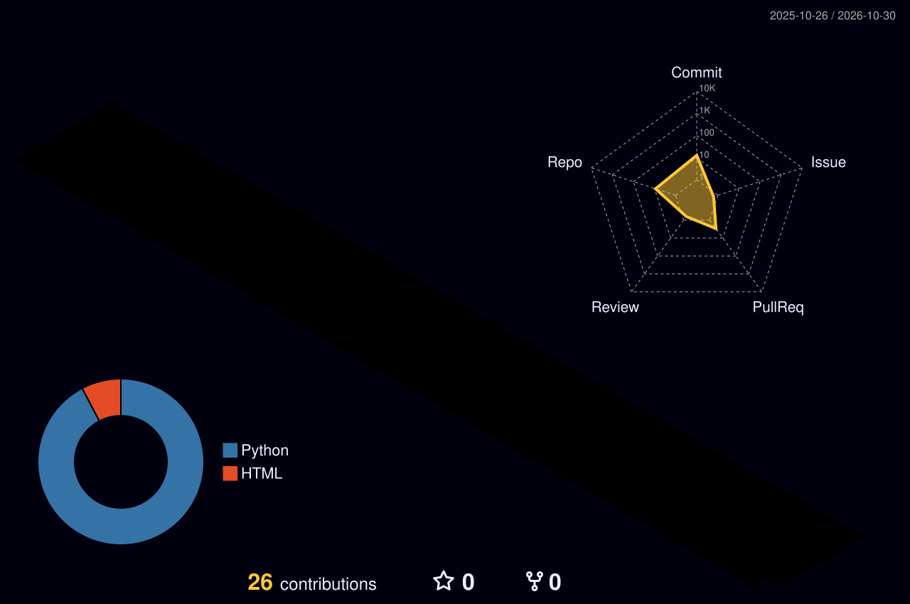

<picture>
  <source media="(prefers-color-scheme: dark)"  srcset="./assets/banner-dark.svg">
  <source media="(prefers-color-scheme: light)" srcset="./assets/banner-light.svg">
  
</picture>

<p align="center">
  <picture>
    <source media="(prefers-color-scheme: dark)"  srcset="https://readme-typing-svg.demolab.com?font=JetBrains+Mono&weight=600&size=26&duration=2600&pause=800&center=true&vCenter=true&width=900&height=60&lines=Data+Manager+%7C+in+data+since+2019+%F0%9F%93%8A;Turning+raw+events+into+decisions+%F0%9F%8E%AE;Learning+Data+Engineering%2C+one+DAG+at+a+time+%E2%9A%99%EF%B8%8F;ClickHouse+%7C+BigQuery+%7C+Airflow+%7C+dbt&color=E6EDF3">
    <source media="(prefers-color-scheme: light)" srcset="https://readme-typing-svg.demolab.com?font=JetBrains+Mono&weight=600&size=26&duration=2600&pause=800&center=true&vCenter=true&width=900&height=60&lines=Data+Manager+%7C+in+data+since+2019+%F0%9F%93%8A;Turning+raw+events+into+decisions+%F0%9F%8E%AE;Learning+Data+Engineering%2C+one+DAG+at+a+time+%E2%9A%99%EF%B8%8F;ClickHouse+%7C+BigQuery+%7C+Airflow+%7C+dbt&color=1F2328">
    
  </picture>
</p>

<p align="center">
  <a href="https://www.tiktok.com/@huydata" target="_blank"></a>
  <a href="https://github.com/huydata2026?tab=repositories"></a>
  
</p>

---

## 🎮 About me

> **"Every tap in a product is a data point. My job is to make those taps tell a story the team can act on."**

- 📊 **Data Manager** with a data career that started in **2019**. I lead a data team and own the analytics stack behind user acquisition, monetisation and live-ops for mobile games.
- 🧱 Hands-on with the warehouse every day: **ClickHouse and BigQuery**, marketing and product events landed, modelled and served as CPI, ROAS, retention and funnel marts.
- ⚙️ Levelling up as a **Data Engineer**: Airflow, dbt, Docker, CI/CD. This profile is part of that journey.
- 🎥 Sharing what I learn on TikTok **[@Huydata](https://www.tiktok.com/@huydata)**: SQL, dashboards and game-analytics stories in Vietnamese.
- 🌱 Currently learning: **dbt + Airflow in production**, data contracts, and how to say no to a 14th dashboard.

<p align="center">
  
  
  
  
</p>

---

## 💼 Journey

<div align="center">
<table>
  <tr>
    <td align="center" valign="top" width="25%">
      <sub>2019</sub><br><br>
      <br><br>
      <b>Started in data</b><br>
      <sub>SQL, dashboards, reporting</sub><br>
      <sub>Learned the craft on real business questions</sub>
    </td>
    <td align="center" valign="middle" width="3%">➔</td>
    <td align="center" valign="top" width="25%">
      <sub>2019 – Present</sub> <br><br>
      <br><br>
      <b>Data Manager</b><br>
      <sub>Mobile games · analytics &amp; UA data</sub><br>
      <sub>Leading a data team, owning the warehouse</sub>
    </td>
    <td align="center" valign="middle" width="3%">➔</td>
    <td align="center" valign="top" width="25%">
      <sub>2026 – Present</sub> <br><br>
      <br><br>
      <b>Data Engineering Program</b><br>
      <sub>Student</sub><br>
      <sub>Airflow · BigQuery · CI/CD · Docker</sub>
    </td>
  </tr>
</table>
</div>

---

## 🛠️ Tech stack

<div align="center">
<table>
  <tr>
    <td align="right" width="22%"><b>🗄️ Warehouse</b></td>
    <td>
      
      
      
      
    </td>
  </tr>
  <tr>
    <td align="right"><b>🔄 Pipelines</b></td>
    <td>
      
      
      
      
      
    </td>
  </tr>
  <tr>
    <td align="right"><b>🎯 Marketing &amp; product data</b></td>
    <td>
      
      
      
      
      
    </td>
  </tr>
  <tr>
    <td align="right"><b>📊 BI</b></td>
    <td>
      
      
      
      
    </td>
  </tr>
  <tr>
    <td align="right"><b>🚀 Platform &amp; DevOps</b></td>
    <td>
      
      
      
      
      
    </td>
  </tr>
  <tr>
    <td align="right"><b>🤖 AI tooling</b></td>
    <td>
      
      
      
    </td>
  </tr>
</table>
</div>

---

## 🚀 Featured

<table>
  <tr>
    <td width="50%" valign="top">
      <h3><a href="https://github.com/huydata2026/candy-crush-airflow1">🍬 candy-crush-airflow</a></h3>
      <p>Production-style <b>Airflow 3 + BigQuery</b> ETL for Candy Crush event data, wrapped in a full <b>CI/CD</b> loop: ruff lint, unit tests, DAG-integrity tests, Docker build and secret scanning on every PR, then an approval-gated deploy over SSH to a GCP VM.</p>
      <p>
        
        
        
        
      </p>
    </td>
    <td width="50%" valign="top">
      <h3><a href="https://www.tiktok.com/@huydata">🎥 @Huydata on TikTok</a></h3>
      <p>Short, practical videos in Vietnamese on <b>SQL, dashboards and game analytics</b>: how to read a retention curve, why your ROAS chart lies, and the queries I actually run at work. New episodes every week.</p>
      <p>
        
        
        
      </p>
    </td>
  </tr>
</table>

### 🕒 Latest projects <sub><sup>auto-updated daily</sup></sub>
<!--START_SECTION:projects-->
| Repository | Description | Stack | Updated |
|---|---|---|---|
| [**huydata20302030**](https://github.com/huydata2026/huydata20302030) | _No description yet_ |  | 1d ago |
| [**huydata123456**](https://github.com/huydata2026/huydata123456) | _No description yet_ |  | 1d ago |
| [**candy-crush-airflow1**](https://github.com/huydata2026/candy-crush-airflow1) | _No description yet_ |  | 1d ago |
| [**candy-crush-airflow**](https://github.com/huydata2026/candy-crush-airflow) | _No description yet_ |  | 3d ago |
| [**Lesson-3-Lab**](https://github.com/huydata2026/Lesson-3-Lab) | _No description yet_ |  | 2mo ago |
<!--END_SECTION:projects-->

---

## 📈 Stats

<picture>
  <source media="(prefers-color-scheme: dark)"  srcset="./profile-3d-contrib/profile-night-rainbow.svg">
  <source media="(prefers-color-scheme: light)" srcset="./profile-3d-contrib/profile-season-animate.svg">
  
</picture>

<div align="center">
<table border="0">
  <tr>
    <td width="50%" align="center" valign="middle">
      <picture>
        <source media="(prefers-color-scheme: dark)"  srcset="https://github-readme-stats.vercel.app/api?username=huydata2026&show_icons=true&include_all_commits=true&count_private=true&hide_border=false&bg_color=0B1020&title_color=F5A524&text_color=E6EDF3&icon_color=38BDF8&border_color=1E2A4A">
        <source media="(prefers-color-scheme: light)" srcset="https://github-readme-stats.vercel.app/api?username=huydata2026&show_icons=true&include_all_commits=true&count_private=true&hide_border=false&bg_color=FFFFFF&title_color=B45309&text_color=1F2328&icon_color=0284C7&border_color=D0D7DE">
        
      </picture>
    </td>
    <td width="50%" align="center" valign="middle">
      <picture>
        <source media="(prefers-color-scheme: dark)"  srcset="https://github-readme-stats.vercel.app/api/top-langs/?username=huydata2026&layout=compact&langs_count=6&hide=html,css,jupyter%20notebook&hide_border=false&bg_color=0B1020&title_color=F5A524&text_color=E6EDF3&icon_color=38BDF8&border_color=1E2A4A">
        <source media="(prefers-color-scheme: light)" srcset="https://github-readme-stats.vercel.app/api/top-langs/?username=huydata2026&layout=compact&langs_count=6&hide=html,css,jupyter%20notebook&hide_border=false&bg_color=FFFFFF&title_color=B45309&text_color=1F2328&icon_color=0284C7&border_color=D0D7DE">
        
      </picture>
    </td>
  </tr>
  <tr>
    <td width="50%" align="center" valign="middle">
      <picture>
        <source media="(prefers-color-scheme: dark)"  srcset="https://streak-stats.demolab.com?user=huydata2026&hide_border=false&background=0B1020&border=1E2A4A&ring=F5A524&fire=F5A524&currStreakLabel=F5A524&currStreakNum=E6EDF3&sideNums=E6EDF3&sideLabels=E6EDF3&dates=8B95A7&stroke=1E2A4A">
        <source media="(prefers-color-scheme: light)" srcset="https://streak-stats.demolab.com?user=huydata2026&hide_border=false&background=FFFFFF&border=D0D7DE&ring=B45309&fire=B45309&currStreakLabel=B45309&currStreakNum=1F2328&sideNums=1F2328&sideLabels=1F2328&dates=57606A&stroke=D0D7DE">
        
      </picture>
    </td>
    <td width="50%" align="center" valign="middle">
      <picture>
        <source media="(prefers-color-scheme: dark)"  srcset="https://github-readme-activity-graph.vercel.app/graph?username=huydata2026&hide_border=true&bg_color=0B1020&color=E6EDF3&line=F5A524&point=38BDF8&title_color=F5A524&area=true&area_color=F5A524">
        <source media="(prefers-color-scheme: light)" srcset="https://github-readme-activity-graph.vercel.app/graph?username=huydata2026&hide_border=true&bg_color=FFFFFF&color=1F2328&line=B45309&point=0284C7&title_color=B45309&area=true&area_color=B45309">
        
      </picture>
    </td>
  </tr>
</table>
</div>

### ⌨️ This week in code <sub><sup>via WakaTime</sup></sub>
<!--START_SECTION:waka-->
```txt
Collecting data… check back in a week ⏳
```
<!--END_SECTION:waka-->

<picture>
  <source media="(prefers-color-scheme: dark)"  srcset="https://raw.githubusercontent.com/huydata2026/huydata2026/snake/snake-dark.svg">
  <source media="(prefers-color-scheme: light)" srcset="https://raw.githubusercontent.com/huydata2026/huydata2026/snake/snake-light.svg">
  
</picture>

---

<p align="center">
  <sub>Built with Markdown, a few SVGs and 4 GitHub Actions that keep this page fresh while I sleep. Palette: <code>#0B1020</code> · <code>#F5A524</code> · <code>#38BDF8</code>.</sub><br>
  <sub>⭐ If something here helped you, a star on a repo makes my day.</sub>
</p>
