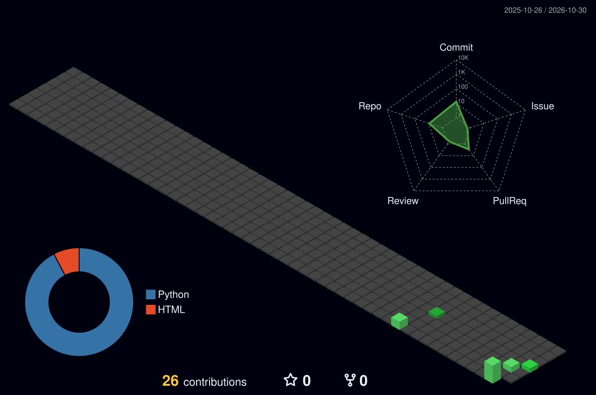

<p align="center">
  
</p>

<p align="center">
  <a href="https://www.tiktok.com/@huydata" target="_blank"></a>
  <a href="https://github.com/huydata2026?tab=repositories"></a>
  
</p>


## `$ whoami`

```bash
Huydata · Data Manager · in data since 2019
```

> **"Every tap in a product is a data point. My job is to make those taps tell a story the team can act on."**

- 📊 **Data Manager** with a data career that started in **2019**. I lead a data team and own the analytics stack behind user acquisition, monetisation and live-ops for mobile games.
- 🧱 Hands-on with the warehouse every day: **ClickHouse and BigQuery**, marketing and product events landed, modelled and served as CPI, ROAS, retention and funnel marts.
- ⚙️ Levelling up as a **Data Engineer**: Airflow, dbt, Docker, CI/CD. This profile is part of that journey.
- 🎥 Sharing what I learn on TikTok **[@Huydata](https://www.tiktok.com/@huydata)**: SQL, dashboards and game-analytics stories in Vietnamese.
- 🌱 Currently learning: **dbt + Airflow in production**, data contracts, and how to say no to a 14th dashboard.

<p align="center">
  
  
  
  
</p>

## `$ history | grep career`

<div align="center">
<table>
  <tr>
    <td align="center" valign="top" width="25%">
      <code>2019</code><br><br>
      <br><br>
      <b>Started in data</b><br>
      <sub>SQL, dashboards, reporting</sub><br>
      <sub>Learned the craft on real business questions</sub>
    </td>
    <td align="center" valign="middle" width="3%"><code>→</code></td>
    <td align="center" valign="top" width="25%">
      <code>2019 – now</code> <br><br>
      <br><br>
      <b>Data Manager</b><br>
      <sub>Mobile games · analytics &amp; UA data</sub><br>
      <sub>Leading a data team, owning the warehouse</sub>
    </td>
    <td align="center" valign="middle" width="3%"><code>→</code></td>
    <td align="center" valign="top" width="25%">
      <code>2026 – now</code> <br><br>
      <br><br>
      <b>Data Engineering Program</b><br>
      <sub>Student</sub><br>
      <sub>Airflow · BigQuery · CI/CD · Docker</sub>
    </td>
  </tr>
</table>
</div>

## `$ ls stack/`

<div align="center">
<table>
  <tr>
    <td align="right" width="22%"><code>warehouse/</code></td>
    <td>
      
      
      
      
    </td>
  </tr>
  <tr>
    <td align="right"><code>pipelines/</code></td>
    <td>
      
      
      
      
      
    </td>
  </tr>
  <tr>
    <td align="right"><code>marketing_data/</code></td>
    <td>
      
      
      
      
      
    </td>
  </tr>
  <tr>
    <td align="right"><code>bi/</code></td>
    <td>
      
      
      
      
    </td>
  </tr>
  <tr>
    <td align="right"><code>platform/</code></td>
    <td>
      
      
      
      
      
      
    </td>
  </tr>
  <tr>
    <td align="right"><code>ai_tooling/</code></td>
    <td>
      
      
      
    </td>
  </tr>
</table>
</div>

## `$ cat featured.md`

<table>
  <tr>
    <td width="50%" valign="top">
      <h3><a href="https://github.com/huydata2026/candy-crush-airflow1">🍬 candy-crush-airflow</a></h3>
      <p>Production-style <b>Airflow 3 + BigQuery</b> ETL for Candy Crush event data, wrapped in a full <b>CI/CD</b> loop: ruff lint, unit tests, DAG-integrity tests, Docker build and secret scanning on every PR, then an approval-gated deploy over SSH to a GCP VM.</p>
      <p>
        
        
        
        
      </p>
    </td>
    <td width="50%" valign="top">
      <h3><a href="https://www.tiktok.com/@huydata">🎥 @Huydata on TikTok</a></h3>
      <p>Short, practical videos in Vietnamese on <b>SQL, dashboards and game analytics</b>: how to read a retention curve, why your ROAS chart lies, and the queries I actually run at work. New episodes every week.</p>
      <p>
        
        
        
      </p>
    </td>
  </tr>
</table>

### `$ ls -t repos/ | head -5` <sub><sup>auto-updated daily</sup></sub>
<!--START_SECTION:projects-->
| Repository | Description | Stack | Updated |
|---|---|---|---|
| [**candy-crush-airflow1**](https://github.com/huydata2026/candy-crush-airflow1) | _No description yet_ |  | today |
| [**candy-crush-airflow**](https://github.com/huydata2026/candy-crush-airflow) | _No description yet_ |  | 2d ago |
| [**Lesson-3-Lab**](https://github.com/huydata2026/Lesson-3-Lab) | _No description yet_ |  | 2mo ago |
| [**Lesson-2-Lab**](https://github.com/huydata2026/Lesson-2-Lab) | _No description yet_ |  | 2mo ago |
<!--END_SECTION:projects-->

## `$ ./stats.sh`



<div align="center">
<table border="0">
  <tr>
    <td width="50%" align="center" valign="middle">
      
    </td>
    <td width="50%" align="center" valign="middle">
      
    </td>
  </tr>
  <tr>
    <td width="50%" align="center" valign="middle">
      
    </td>
    <td width="50%" align="center" valign="middle">
      
    </td>
  </tr>
</table>
</div>

### `$ wakatime --last-7-days`
<!--START_SECTION:waka-->
```txt
Collecting data… check back in a week ⏳
```
<!--END_SECTION:waka-->


<p align="center">
  <sub><code>built with</code> markdown · svg · 4 github actions that keep this page fresh while I sleep</sub><br>
  <sub><code>palette</code> #000000 · #00FF41 · #C9D1D9 &nbsp;|&nbsp; <code>uptime</code> since 2019</sub><br>
  <sub>⭐ if something here helped you, a star on a repo makes my day.</sub>
</p>
